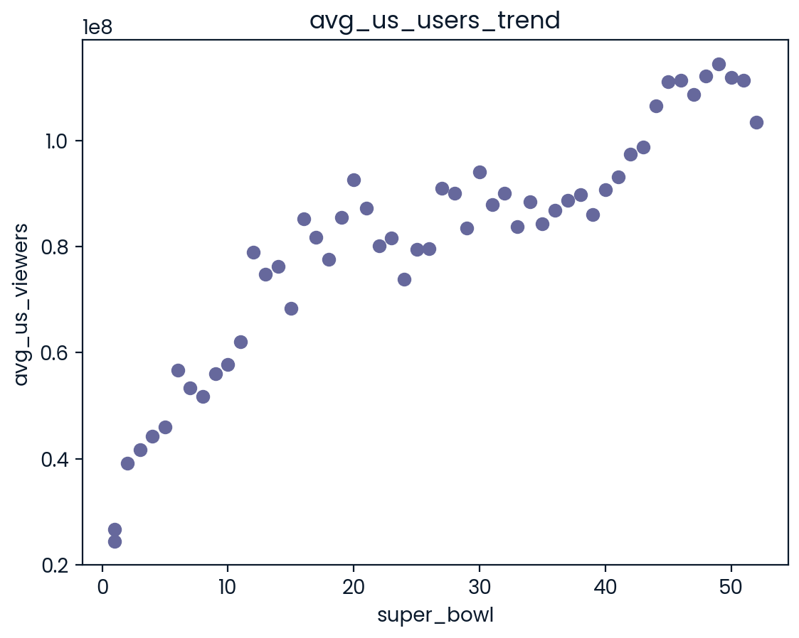

## Super Bowl Analysis: Scores, TV Viewership & Halftime Shows

Exploratory data analysis of 52 Super Bowls (through 2018) using Python, pandas and matplotlib. Completed as a guided DataCamp project.

## Overview

The Super Bowl is part drama, part advertising showcase and part concert. This project explores that spectacle through data: how lopsided the games have been, whether more people are watching, and who has headlined the halftime show the most.

## Dataset

Three CSV files, scraped and cleaned from Wikipedia:

| File | Contents |
|---|---|
| `super_bowls.csv` | Game details: date, location, participating teams, scores and the points difference between winner and loser (`difference_pts`) |
| `tv.csv` | TV viewership statistics and advertisement costs for each Super Bowl |
| `halftime_musicians.csv` | Halftime performers per Super Bowl (`super_bowl`, `musician`, `num_songs`) |

## Questions Answered

1. **Has TV viewership increased over time?**
   Plotted average US viewers against Super Bowl number in a scatter plot.
   **Answer:** Yes. Viewership shows a clear upward trend, from roughly 25 million viewers at Super Bowl 1 to over 110 million in recent years (`viewership_increased = True`).

   

2. **How many matches finished with a point difference greater than 40?**
   Filtered `super_bowls` on `difference_pts > 40` and counted the rows.
   **Answer:** 1 game: Super Bowl XXIV, where the San Francisco 49ers beat the Denver Broncos 55-10, a 45-point margin. It's the only blowout of that size in the dataset.

3. **Who performed the most songs in a Super Bowl halftime show?**
   Used `idxmax()` on `num_songs` to find the row with the highest count and read the performer's name from it.
   **Answer:** Justin Timberlake, who performed 11 songs in a single halftime show.

## Approach

- Loaded the three datasets with `pandas`
- Filtered rows with boolean conditions
- Used `len()` to count the filtered rows
- Used `idxmax()` with `.loc[]` to look up a name from the row holding the maximum value
- Visualised the viewership trend with a `matplotlib` scatter plot

## Tools

Python, pandas, matplotlib, Jupyter Notebook

## Repository Contents

- `notebook.ipynb`: full analysis with code and outputs
- `datasets/`: the three CSV files
- `images/`: chart used in this README

## How to Run

```bash
pip install pandas matplotlib jupyter
jupyter notebook
```

Open the notebook and run all cells. The CSV files must be in the `datasets/` folder.

## Author

Unnati Rai | [LinkedIn](https://www.linkedin.com/in/unnatirai/) | [GitHub](https://github.com/unnatirai21)
